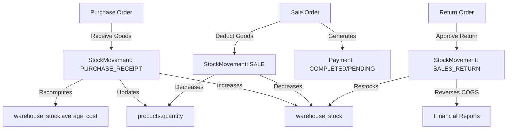

# StockFlow Database Audit & Relational Integrity Assessment

## Executive Summary

StockFlow is a multi-role inventory management, purchasing, point-of-sale, and financial reporting system backed by Spring Boot 3.2.3, Hibernate 6, PostgreSQL 15/16, and Redis 7. 

This audit evaluates the current schema, entity modeling, constraints, index coverage, transaction boundaries, and schema lifecycle management. While the business logic in the service layer is structured with domain separation (e.g., `FinancialCalculations`, `StockLedgerService`, `WarehouseStockService`), the database layer currently exhibits critical architectural risks stemming from:
1. Complete reliance on `spring.jpa.hibernate.ddl-auto=update` without versioned database migration scripts (Flyway/Liquibase).
2. Runtime DDL failures that Hibernate quietly ignores on populated tables (e.g. `ALTER TABLE ... ADD COLUMN ... NOT NULL` failures that previously broke production endpoints).
3. Inconsistent monetary scale and precision between parent documents, transaction lines, and ledger records.
4. Total absence of database-level `CHECK` constraints to enforce non-negative stock, non-negative amounts, and positive quantities independently of the application layer.
5. Incomplete foreign key cascade controls and index gaps on composite query filters.

---

## 1. Environment & Architecture Overview

| Component | Current Configuration | Target Production Configuration |
| :--- | :--- | :--- |
| **RDBMS Engine** | PostgreSQL 15-alpine (Docker Compose / Render) | PostgreSQL 15 or 16 with ACID transactions and strict constraints |
| **Schema Management** | `ddl-auto=update` + `PerformanceIndexInitializer` | Versioned SQL migrations (Flyway) + Hibernate `ddl-auto=validate` |
| **Connection Pooling** | HikariCP (`maximum-pool-size=10`, `minimum-idle=2`) | HikariCP tuned with connection & socket timeouts |
| **ORM / Data Access** | Spring Data JPA + Hibernate 6.4.4 | Spring Data JPA with explicit locking & validation |
| **Distributed Cache** | Redis 7 (rate limiting, lookup cache) | Redis 7 with graceful in-memory degradation |
| **Test Strategy** | Testcontainers `postgres:16-alpine` (`@ServiceConnection`) | Isolated ephemeral Testcontainers for CI/CD |

---

## 2. Complete Entity & Table Inventory

The application currently models **26 relational database tables** mapped across domain entities:

### 2.1 Identity & Access Management

#### `users`
- **Table:** `users`
- **Columns:**
  - `id` (BIGSERIAL, PRIMARY KEY)
  - `username` (VARCHAR(255), NOT NULL, UNIQUE)
  - `first_name` (VARCHAR(255), NOT NULL)
  - `last_name` (VARCHAR(255), NOT NULL)
  - `email` (VARCHAR(255), NOT NULL, UNIQUE)
  - `password_hash` (VARCHAR(255), NOT NULL)
  - `phone` (VARCHAR(255), NULL)
  - `gender` (VARCHAR(255), NULL)
  - `date_of_birth` (DATE, NULL)
  - `address` (VARCHAR(1000), NULL)
  - `profile_photo_url` (VARCHAR(255), NULL)
  - `employee_id` (VARCHAR(255), UNIQUE)
  - `job_title` (VARCHAR(255), NULL)
  - `department` (VARCHAR(255), NULL)
  - `branch` (VARCHAR(255), NULL)
  - `warehouse` (VARCHAR(255), NULL)
  - `tenant_id` (VARCHAR(255), NULL)
  - `date_joined` (DATE, NULL)
  - `role_id` (BIGINT, FK -> `roles.id`, NULL)
  - `status` (VARCHAR(255), NOT NULL, DEFAULT 'ACTIVE')
  - `last_login_at` (TIMESTAMP, NULL)
  - `password_reset_required` (BOOLEAN, DEFAULT FALSE)
  - `is_deleted` (BOOLEAN, DEFAULT FALSE)
  - `deleted_at` (TIMESTAMP, NULL)
  - `deleted_by` (BIGINT, NULL)
  - `created_at` (TIMESTAMP)
  - `updated_at` (TIMESTAMP)
- **Indexes:** `idx_users_role (role_id)`, `idx_users_status (status)`, `idx_users_tenant (tenant_id)`
- **Relationships:** Many-to-One with `Role` (`FetchType.EAGER`)

#### `roles`
- **Table:** `roles`
- **Columns:**
  - `id` (BIGSERIAL, PRIMARY KEY)
  - `name` (VARCHAR(255), NOT NULL, UNIQUE)
  - `description` (VARCHAR(255), NULL)
- **Relationships:** Many-to-Many with `Permission` via `role_permissions`

#### `permissions`
- **Table:** `permissions`
- **Columns:**
  - `id` (BIGSERIAL, PRIMARY KEY)
  - `name` (VARCHAR(255), NOT NULL, UNIQUE)

#### `role_permissions` (Join Table)
- **Columns:** `role_id` (FK -> `roles.id`), `permission_id` (FK -> `permissions.id`)
- **Primary Key:** `(role_id, permission_id)`

---

### 2.2 Product Catalog & Inventory

#### `categories`
- **Table:** `categories`
- **Columns:**
  - `id` (BIGSERIAL, PRIMARY KEY)
  - `name` (VARCHAR(255), NOT NULL)
  - `description` (VARCHAR(255), NULL)
  - `parent_id` (BIGINT, FK -> `categories.id`, NULL)
- **Indexes:** `idx_categories_parent (parent_id)`
- **Relationships:** Self-referencing Many-to-One (`parent`), One-to-Many (`subCategories`)

#### `products`
- **Table:** `products`
- **Columns:**
  - `id` (BIGSERIAL, PRIMARY KEY)
  - `sku` (VARCHAR(255), NOT NULL, UNIQUE)
  - `barcode` (VARCHAR(255), NULL)
  - `name` (VARCHAR(255), NOT NULL)
  - `unit` (VARCHAR(255), NULL)
  - `description` (VARCHAR(255), NULL)
  - `category_id` (BIGINT, FK -> `categories.id`, NULL)
  - `purchase_price` (NUMERIC(10,2), NULL)
  - `selling_price` (NUMERIC(10,2), NULL)
  - `min_selling_price` (NUMERIC(10,2), NULL)
  - `min_stock_level` (INTEGER, NULL)
  - `max_stock_level` (INTEGER, NULL)
  - `reorder_level` (INTEGER, NULL)
  - `batch_tracked` (BOOLEAN, NOT NULL, DEFAULT FALSE)
  - `expiry_tracked` (BOOLEAN, NOT NULL, DEFAULT FALSE)
  - `active` (BOOLEAN, NOT NULL, DEFAULT TRUE)
  - `quantity` (INTEGER, NOT NULL, DEFAULT 0)
  - `created_at` (TIMESTAMP)
  - `updated_at` (TIMESTAMP)
- **Indexes:** 
  - `idx_products_name_lower (LOWER(name))`
  - `idx_products_sku_lower (LOWER(sku))`
  - `idx_products_barcode_lower (LOWER(barcode))`
  - `idx_products_active_qty (active, quantity)`
  - `idx_products_category (category_id)`
- **Integrity Issues:** `quantity` lacks a database-level `CHECK (quantity >= 0)`.

#### `warehouses`
- **Table:** `warehouses`
- **Columns:**
  - `id` (BIGSERIAL, PRIMARY KEY)
  - `name` (VARCHAR(255), NOT NULL, UNIQUE)
  - `location` (VARCHAR(255), NULL)
  - `manager_name` (VARCHAR(255), NULL)
  - `contact_phone` (VARCHAR(255), NULL)
  - `active` (BOOLEAN, NOT NULL, DEFAULT TRUE)
  - `created_at` (TIMESTAMP)
  - `updated_at` (TIMESTAMP)
- **Indexes:** `idx_warehouses_active (active)`

#### `warehouse_stock`
- **Table:** `warehouse_stock`
- **Columns:**
  - `id` (BIGSERIAL, PRIMARY KEY)
  - `product_id` (BIGINT, NOT NULL, FK -> `products.id`)
  - `warehouse_id` (BIGINT, NOT NULL, FK -> `warehouses.id`)
  - `quantity` (INTEGER, NOT NULL)
  - `average_cost` (NUMERIC(12,4), NULL)
  - `last_movement_at` (TIMESTAMP, NULL)
- **Constraints:** `UNIQUE (product_id, warehouse_id)`
- **Indexes:** `idx_warehouse_stock_product (product_id)`, `idx_warehouse_stock_warehouse (warehouse_id)`
- **Integrity Issues:** Missing database-level `CHECK (quantity >= 0)`.

#### `stock_movements`
- **Table:** `stock_movements`
- **Columns:**
  - `id` (BIGSERIAL, PRIMARY KEY)
  - `product_id` (BIGINT, NOT NULL, FK -> `products.id`)
  - `warehouse_id` (BIGINT, NULL, FK -> `warehouses.id`)
  - `destination_warehouse_id` (BIGINT, NULL, FK -> `warehouses.id`)
  - `type` (VARCHAR(255), NOT NULL)
  - `quantity` (INTEGER, NOT NULL)  -- Signed: + for IN, - for OUT
  - `reference` (VARCHAR(255), NULL)
  - `reason` (VARCHAR(255), NULL)
  - `movement_group` (VARCHAR(80), NULL)
  - `unit_cost` (NUMERIC(12,4), NULL)
  - `notes` (VARCHAR(255), NULL)
  - `created_by_id` (BIGINT, NULL, FK -> `users.id`)
  - `status` (VARCHAR(16), NULL, DEFAULT 'APPROVED')
  - `approved_by_id` (BIGINT, NULL, FK -> `users.id`)
  - `approved_at` (TIMESTAMP, NULL)
  - `review_note` (VARCHAR(255), NULL)
  - `created_at` (TIMESTAMP)
- **Indexes:** 
  - `idx_stock_moves_product (product_id)`
  - `idx_stock_moves_warehouse (warehouse_id)`
  - `idx_stock_moves_type (type)`
  - `idx_stock_moves_created_at (created_at DESC)`
- **Missing Index:** Compound index `(product_id, warehouse_id, status)` heavily queried by ledger balance functions.

---

### 2.3 Customers & Suppliers

#### `customers`
- **Table:** `customers`
- **Columns:**
  - `id` (BIGSERIAL, PRIMARY KEY)
  - `customer_number` (VARCHAR(255), NOT NULL, UNIQUE)
  - `name` (VARCHAR(255), NOT NULL)
  - `phone` (VARCHAR(255), NULL)
  - `email` (VARCHAR(255), NULL)
  - `address` (VARCHAR(255), NULL)
  - `customer_type` (VARCHAR(255), NOT NULL, DEFAULT 'RETAIL')
  - `credit_limit` (NUMERIC(12,2), DEFAULT 0.00)
  - `outstanding_balance` (NUMERIC(12,2), DEFAULT 0.00)
  - `status` (VARCHAR(255), NOT NULL, DEFAULT 'ACTIVE')
  - `notes` (VARCHAR(255), NULL)
  - `created_at` (TIMESTAMP)
  - `updated_at` (TIMESTAMP)
- **Indexes:** `idx_customers_name_lower (LOWER(name))`, `idx_customers_status (status)`, `idx_customers_created_at (created_at DESC)`

#### `suppliers`
- **Table:** `suppliers`
- **Columns:**
  - `id` (BIGSERIAL, PRIMARY KEY)
  - `supplier_number` (VARCHAR(255), NOT NULL, UNIQUE)
  - `company_name` (VARCHAR(255), NOT NULL)
  - `contact_person` (VARCHAR(255), NULL)
  - `phone` (VARCHAR(255), NULL)
  - `email` (VARCHAR(255), NULL)
  - `address` (VARCHAR(255), NULL)
  - `tax_number` (VARCHAR(255), NULL)
  - `payment_terms` (VARCHAR(255), NULL)
  - `outstanding_balance` (NUMERIC(12,2), DEFAULT 0.00)
  - `status` (VARCHAR(255), NOT NULL, DEFAULT 'ACTIVE')
  - `notes` (VARCHAR(255), NULL)
  - `created_at` (TIMESTAMP)
  - `updated_at` (TIMESTAMP)
- **Indexes:** `idx_suppliers_company_lower (LOWER(company_name))`, `idx_suppliers_status (status)`

---

### 2.4 Purchasing & Inbound Orders

#### `purchase_orders`
- **Table:** `purchase_orders`
- **Columns:**
  - `id` (BIGSERIAL, PRIMARY KEY)
  - `order_number` (VARCHAR(255), NOT NULL, UNIQUE)
  - `supplier_name` (VARCHAR(255), NULL)
  - `supplier_id` (BIGINT, NULL, FK -> `suppliers.id`)
  - `warehouse_id` (BIGINT, NULL, FK -> `warehouses.id`)
  - `total_amount` (NUMERIC(12,2), NULL)
  - `status` (VARCHAR(255), NULL) -- DRAFT, ORDERED, PARTIALLY_RECEIVED, RECEIVED, CANCELLED, RETURNED
  - `payment_status` (VARCHAR(20), NULL) -- PAID, PARTIAL, UNPAID
  - `amount_paid` (NUMERIC(12,2), NULL)
  - `payment_terms` (VARCHAR(60), NULL)
  - `due_date` (DATE, NULL)
  - `expected_delivery_date` (DATE, NULL)
  - `tax` (NUMERIC(12,2), NULL)
  - `discount` (NUMERIC(12,2), NULL)
  - `currency` (VARCHAR(3), DEFAULT 'ETB')
  - `created_by_id` (BIGINT, NULL, FK -> `users.id`)
  - `transaction_date` (TIMESTAMP, NULL)
  - `approved_by_id` (BIGINT, NULL, FK -> `users.id`)
  - `approved_at` (TIMESTAMP, NULL)
  - `created_at` (TIMESTAMP)
- **Indexes:** `idx_purchase_orders_status (status)`, `idx_purchase_orders_created_at (created_at DESC)`

#### `purchase_order_items`
- **Table:** `purchase_order_items`
- **Columns:**
  - `id` (BIGSERIAL, PRIMARY KEY)
  - `purchase_order_id` (BIGINT, NOT NULL, FK -> `purchase_orders.id`)
  - `product_id` (BIGINT, NOT NULL, FK -> `products.id`)
  - `quantity` (INTEGER, NULL)
  - `quantity_received` (INTEGER, NULL)
  - `quantity_returned` (INTEGER, NULL)
  - `unit_cost` (NUMERIC(10,2), NULL)
  - `subtotal` (NUMERIC(10,2), NULL)
  - `tax` (NUMERIC(12,2), NULL)
  - `discount` (NUMERIC(12,2), NULL)
- **Indexes:** `idx_purchase_items_order (purchase_order_id)`, `idx_purchase_items_product (product_id)`

---

### 2.5 Sales & Point of Sale

#### `sale_orders`
- **Table:** `sale_orders`
- **Columns:**
  - `id` (BIGSERIAL, PRIMARY KEY)
  - `order_number` (VARCHAR(255), NOT NULL, UNIQUE)
  - `customer_name` (VARCHAR(255), NULL)
  - `customer_id` (BIGINT, NULL, FK -> `customers.id`)
  - `warehouse_id` (BIGINT, NULL, FK -> `warehouses.id`)
  - `total_amount` (NUMERIC(10,2), NULL)
  - `discount` (NUMERIC(10,2), NULL)
  - `tax` (NUMERIC(10,2), NULL)
  - `final_amount` (NUMERIC(10,2), NULL)
  - `amount_paid` (NUMERIC(12,2), NULL)
  - `cost_of_goods_sold` (NUMERIC(12,2), NULL)
  - `status` (VARCHAR(255), NULL)
  - `payment_status` (VARCHAR(255), NULL)
  - `payment_method` (VARCHAR(255), NULL)
  - `transaction_date` (TIMESTAMP, NULL)
  - `currency` (VARCHAR(3), DEFAULT 'ETB')
  - `created_by_id` (BIGINT, NULL, FK -> `users.id`)
  - `idempotency_key` (VARCHAR(255), UNIQUE)
  - `void_status` (VARCHAR(16), NULL)
  - `void_reason` (VARCHAR(255), NULL)
  - `void_requested_by_id` (BIGINT, NULL, FK -> `users.id`)
  - `void_requested_at` (TIMESTAMP, NULL)
  - `void_approved_by_id` (BIGINT, NULL, FK -> `users.id`)
  - `void_approved_at` (TIMESTAMP, NULL)
  - `void_review_note` (VARCHAR(255), NULL)
  - `refund_status` (VARCHAR(16), NULL)
  - `refund_reason` (VARCHAR(255), NULL)
  - `refund_requested_by_id` (BIGINT, NULL, FK -> `users.id`)
  - `refund_requested_at` (TIMESTAMP, NULL)
  - `refund_approved_by_id` (BIGINT, NULL, FK -> `users.id`)
  - `refund_approved_at` (TIMESTAMP, NULL)
  - `refund_review_note` (VARCHAR(255), NULL)
  - `created_at` (TIMESTAMP)
- **Indexes:** 
  - `idx_sale_orders_status (status)`
  - `idx_sale_orders_created_at (created_at DESC)`
  - `idx_sale_orders_customer (customer_id)`
  - `idx_sale_orders_created_by (created_by_id)`
  - `idx_sale_orders_pay_method (payment_method)`
  - `idx_sale_orders_idempotency (idempotency_key)`

#### `sale_order_items`
- **Table:** `sale_order_items`
- **Columns:**
  - `id` (BIGSERIAL, PRIMARY KEY)
  - `sale_order_id` (BIGINT, NOT NULL, FK -> `sale_orders.id`)
  - `product_id` (BIGINT, NOT NULL, FK -> `products.id`)
  - `quantity` (INTEGER, NULL)
  - `unit_price` (NUMERIC(10,2), NULL)
  - `discount` (NUMERIC(10,2), NULL)
  - `subtotal` (NUMERIC(10,2), NULL)
  - `unit_cost` (NUMERIC(12,4), NULL)
  - `quantity_returned` (INTEGER, NOT NULL, DEFAULT 0)
- **Indexes:** `idx_sale_items_sale_order (sale_order_id)`, `idx_sale_items_product (product_id)`

---

### 2.6 Returns & Exchanges

#### `return_orders`
- **Table:** `return_orders`
- **Columns:**
  - `id` (BIGSERIAL, PRIMARY KEY)
  - `return_number` (VARCHAR(255), NOT NULL, UNIQUE)
  - `return_type` (VARCHAR(20), NOT NULL) -- SALES_RETURN, PURCHASE_RETURN
  - `original_reference` (VARCHAR(255), NULL)
  - `party_name` (VARCHAR(255), NULL)
  - `customer_id` (BIGINT, NULL, FK -> `customers.id`)
  - `supplier_id` (BIGINT, NULL, FK -> `suppliers.id`)
  - `warehouse_id` (BIGINT, NULL, FK -> `warehouses.id`)
  - `total_amount` (NUMERIC(12,2), NULL)
  - `status` (VARCHAR(16), NULL) -- PENDING, APPROVED, REJECTED
  - `reason` (VARCHAR(255), NULL)
  - `notes` (VARCHAR(1000), NULL)
  - `financial_settled` (BOOLEAN, NOT NULL, DEFAULT FALSE)
  - `requested_by_id` (BIGINT, NULL, FK -> `users.id`)
  - `approved_by_id` (BIGINT, NULL, FK -> `users.id`)
  - `approved_at` (TIMESTAMP, NULL)
  - `review_note` (VARCHAR(1000), NULL)
  - `transaction_date` (TIMESTAMP, NULL)
  - `created_at` (TIMESTAMP)

#### `return_order_items`
- **Table:** `return_order_items`
- **Columns:**
  - `id` (BIGSERIAL, PRIMARY KEY)
  - `return_order_id` (BIGINT, NOT NULL, FK -> `return_orders.id`)
  - `product_id` (BIGINT, NOT NULL, FK -> `products.id`)
  - `sale_order_item_id` (BIGINT, NULL, FK -> `sale_order_items.id`)
  - `purchase_order_item_id` (BIGINT, NULL, FK -> `purchase_order_items.id`)
  - `quantity` (INTEGER, NULL)
  - `unit_price` (NUMERIC(12,2), NULL)
  - `unit_cost` (NUMERIC(12,4), NULL)
  - `amount` (NUMERIC(12,2), NULL)
  - `tax` (NUMERIC(12,2), NULL)

---

### 2.7 Finance & Ledger

#### `payments`
- **Table:** `payments`
- **Columns:**
  - `id` (BIGSERIAL, PRIMARY KEY)
  - `reference` (VARCHAR(255), NULL)
  - `order_reference` (VARCHAR(255), NULL)
  - `type` (VARCHAR(255), NULL)
  - `direction` (VARCHAR(3), NULL) -- IN, OUT
  - `party_type` (VARCHAR(20), NULL) -- CUSTOMER, SUPPLIER, OTHER
  - `customer_id` (BIGINT, NULL, FK -> `customers.id`)
  - `supplier_id` (BIGINT, NULL, FK -> `suppliers.id`)
  - `sale_order_id` (BIGINT, NULL, FK -> `sale_orders.id`)
  - `purchase_order_id` (BIGINT, NULL, FK -> `purchase_orders.id`)
  - `amount` (NUMERIC(12,2), NULL)
  - `payment_method` (VARCHAR(40), NULL)
  - `status` (VARCHAR(255), DEFAULT 'COMPLETED')
  - `transaction_date` (TIMESTAMP, NULL)
  - `external_reference` (VARCHAR(120), NULL)
  - `notes` (VARCHAR(255), NULL)
  - `created_by` (VARCHAR(255), NULL)
  - `created_by_id` (BIGINT, NULL, FK -> `users.id`)
  - `created_at` (TIMESTAMP)
  - `updated_at` (TIMESTAMP)
- **Indexes:**
  - `idx_payments_direction (direction)`
  - `idx_payments_transaction_date (transaction_date)`
  - `idx_payments_sale_order (sale_order_id)`
  - `idx_payments_purchase_order (purchase_order_id)`
  - `idx_payments_order_ref (order_reference)`
  - `idx_payments_type (type)`
  - `idx_payments_created_at (created_at DESC)`

#### `expenses`
- **Table:** `expenses`
- **Columns:**
  - `id` (BIGSERIAL, PRIMARY KEY)
  - `reference` (VARCHAR(255), NULL)
  - `category` (VARCHAR(255), NULL)
  - `amount` (NUMERIC(12,2), NULL)
  - `description` (VARCHAR(255), NULL)
  - `status` (VARCHAR(255), DEFAULT 'PENDING')
  - `transaction_date` (TIMESTAMP, NULL)
  - `notes` (VARCHAR(255), NULL)
  - `created_by` (VARCHAR(255), NULL)
  - `created_by_id` (BIGINT, NULL, FK -> `users.id`)
  - `approved_by_id` (BIGINT, NULL, FK -> `users.id`)
  - `approved_at` (TIMESTAMP, NULL)
  - `created_at` (TIMESTAMP)
  - `updated_at` (TIMESTAMP)
- **Indexes:** `idx_expenses_transaction_date (transaction_date)`

---

### 2.8 Audit & System Governance

#### `audit_logs`
- **Table:** `audit_logs`
- **Columns:**
  - `id` (BIGSERIAL, PRIMARY KEY)
  - `user_id` (BIGINT, NULL)
  - `username` (VARCHAR(255), NULL)
  - `action` (VARCHAR(255), NOT NULL)
  - `entity_type` (VARCHAR(255), NULL)
  - `entity_id` (VARCHAR(255), NULL)
  - `previous_value` (TEXT, NULL)
  - `new_value` (TEXT, NULL)
  - `ip_address` (VARCHAR(255), NULL)
  - `timestamp` (TIMESTAMP)
- **Indexes:** `idx_audit_logs_user (user_id)`, `idx_audit_logs_timestamp (timestamp DESC)`

---

### 2.9 Intelligence & Customer Support

#### `ai_model_versions`
- **Table:** `ai_model_versions`
- **Columns:** `id`, `model_key`, `algorithm`, `candidate_metrics` (TEXT), `version`, `training_period_start`, `training_period_end`, `sample_size`, `mae`, `rmse`, `mape`, `hyperparameters` (TEXT), `active`, `trained_at`.
- **Indexes:** `idx_ai_model_key_active (model_key, active)`, `idx_ai_model_trained_at (trained_at)`

#### `ai_query_log`
- **Table:** `ai_query_log`
- **Columns:** `id`, `user_id`, `username`, `question`, `intent`, `confidence`, `service_called`, `parameters` (TEXT), `result_summary` (TEXT), `response_ms`, `error_message`, `created_at`.
- **Indexes:** `idx_ai_query_log_user (user_id)`, `idx_ai_query_log_created_at (created_at DESC)`

#### `chat_conversations`
- **Table:** `chat_conversations`
- **Columns:** `id`, `actor_type` (STAFF, CUSTOMER), `actor_id`, `session_token_hash`, `title`, `created_at`, `last_message_at`, `updated_at`, `expires_at`, `staff_handoff`, `handoff_user_id`.

#### `chat_messages`
- **Table:** `chat_messages`
- **Columns:** `id`, `conversation_id` (FK -> `chat_conversations.id`), `role` (USER, ASSISTANT, TOOL), `content` (TEXT), `tool_name`, `deterministic`, `guard_intervened`, `created_at`.

#### `chat_customer_sessions`
- **Table:** `chat_customer_sessions`
- **Columns:** `id`, `customer_id`, `customer_name`, `token_hash`, `created_at`, `expires_at`, `verified_order_number`.

#### `chat_support_tickets`
- **Table:** `chat_support_tickets`
- **Columns:** `id`, `conversation_id`, `customer_id`, `customer_name`, `reason` (TEXT), `summary` (TEXT), `status` (OPEN, IN_PROGRESS, RESOLVED, CLOSED), `raised_by_type`, `raised_by_id`, `assigned_to_id`, `created_at`, `updated_at`, `resolved_at`.

---

## 3. Findings & Vulnerabilities

### Finding 1 [CRITICAL]: Unmanaged Schema Evolution (`ddl-auto=update`)
- **Impact:** When entity fields grow new `NOT NULL` columns or modified types, PostgreSQL throws an error on existing populated rows. Hibernate suppresses this as a warning and proceeds with startup. The application reports healthy in container orchestrators (Render / Kubernetes), but any query referencing the unadded column crashes with HTTP 500.
- **Evidence in Code:** `StockMovementStatusBackfill.java` contains documentation detailing how this exact issue occurred in production on `stock_movements.status`.
- **Remediation:** Introduce Flyway versioned migrations (`V1__...`, `V2__...`). Set `spring.jpa.hibernate.ddl-auto=validate` in production to ensure schema compliance before startup.

### Finding 2 [CRITICAL]: Absence of Database-Level Negative Stock & Monetary Check Constraints
- **Impact:** Application logic checks for sufficient stock via `warehouseStockService.quantityIn(productId, warehouseId)` and pessimistic locks (`findForUpdate`). However, there are no database constraints guaranteeing `quantity >= 0` on `products` or `warehouse_stock`. Any out-of-band update, script, or uncaught race condition could permit negative inventory.
- **Remediation:** Add PostgreSQL check constraints:
  - `ALTER TABLE products ADD CONSTRAINT chk_products_quantity_non_negative CHECK (quantity >= 0);`
  - `ALTER TABLE warehouse_stock ADD CONSTRAINT chk_warehouse_stock_quantity_non_negative CHECK (quantity >= 0);`
  - `ALTER TABLE sale_order_items ADD CONSTRAINT chk_sale_items_qty_positive CHECK (quantity > 0);`
  - `ALTER TABLE purchase_order_items ADD CONSTRAINT chk_purchase_items_qty_positive CHECK (quantity > 0);`
  - `ALTER TABLE payments ADD CONSTRAINT chk_payments_amount_positive CHECK (amount > 0);`

### Finding 3 [HIGH]: Monetary Precision Discrepancies
- **Impact:** `SaleOrder` uses `NUMERIC(10,2)` for `total_amount` and `final_amount`, while `amount_paid` and `cost_of_goods_sold` use `NUMERIC(12,2)`. `PurchaseOrderItem.unit_cost` is `NUMERIC(10,2)`, while `SaleOrderItem.unit_cost` and `StockMovement.unit_cost` use `NUMERIC(12,4)`. This introduces rounding and truncation risks when reconciling costs across modules.
- **Remediation:** Standardize all currency amounts to `NUMERIC(15,2)` and all unit costs / valuation rates to `NUMERIC(15,4)`.

### Finding 4 [MEDIUM]: Composite Index Gaps for Reporting Queries
- **Impact:** Reporting queries filter on date ranges and status simultaneously (e.g., `WHERE s.transactionDate BETWEEN :from AND :to AND s.status <> 'CANCELLED'`). Existing indexes are single-column (e.g. `idx_sale_orders_status`, `idx_sale_orders_created_at`). Under high data volume, this forces index merge or bitmap heap scans.
- **Remediation:** Add composite indexes:
  - `CREATE INDEX idx_sale_orders_report ON sale_orders (transaction_date, status);`
  - `CREATE INDEX idx_payments_report ON payments (transaction_date, status, direction);`
  - `CREATE INDEX idx_stock_movements_ledger ON stock_movements (product_id, warehouse_id, status);`
  - `CREATE INDEX idx_expenses_report ON expenses (transaction_date, status);`

---

## 4. Business Workflow Verification

1. **Purchases:** Receiving is decoupled from creation. Stock only increments upon `receivePurchase()`, preventing phantom inventory.
2. **Sales:** Uses pessimistic locking (`PESSIMISTIC_WRITE`) on `Product` and `WarehouseStock`, preventing concurrent overselling.
3. **Audit Trail:** Every inventory modification generates an immutable `StockMovement` entry linked to an actor, warehouse, product, and cost snapshot.

---

## 5. Migration Roadmap to Production-Ready Database

1. **Phase 1: Baseline Extraction & Schema Freeze**
   - Extract the complete baseline DDL representing the active entities, constraints, and indexes into `src/main/resources/db/migration/V1__initial_schema.sql`.
2. **Phase 2: Database Integrity Constraints**
   - Introduce `V2__add_integrity_constraints.sql` with check constraints for non-negative inventory, valid amounts, and consistent precision.
3. **Phase 3: Index Harmonization**
   - Incorporate all statements from `performance-indexes.sql` into Flyway versioned migrations and retire the programmatic `PerformanceIndexInitializer` to prevent startup drift.
4. **Phase 4: Hibernate Validation**
   - Configure `spring.jpa.hibernate.ddl-auto=validate` for production and ensure all integration tests validate against the Flyway-migrated test database.
