# StockFlow Target Relational Database Design Specification

## Overview

This document specifies the target relational schema for the StockFlow inventory management, purchasing, sales, and financial intelligence system. It formalizes all tables, constraints, foreign keys, numeric scales, and indexes, establishing a single source of truth for production database deployments.

---

## 1. Domain Entity Relationship Diagram

```mermaid
erDiagram
    users ||--o{ roles : "has"
    roles ||--|{ role_permissions : "contains"
    permissions ||--|{ role_permissions : "contained_in"

    categories ||--o{ categories : "sub-category"
    categories ||--o{ products : "categorizes"

    warehouses ||--o{ warehouse_stock : "holds"
    products ||--o{ warehouse_stock : "stocked_at"

    products ||--o{ stock_movements : "tracked_in"
    warehouses ||--o{ stock_movements : "source_location"
    warehouses ||--o{ stock_movements : "dest_location"
    users ||--o{ stock_movements : "recorded_by"

    suppliers ||--o{ purchase_orders : "supplies"
    warehouses ||--o{ purchase_orders : "delivers_to"
    purchase_orders ||--|{ purchase_order_items : "lines"
    products ||--o{ purchase_order_items : "ordered_item"

    customers ||--o{ sale_orders : "purchased_by"
    warehouses ||--o{ sale_orders : "fulfilled_from"
    sale_orders ||--|{ sale_order_items : "lines"
    products ||--o{ sale_order_items : "sold_item"

    return_orders ||--|{ return_order_items : "lines"
    products ||--o{ return_order_items : "returned_item"
    sale_order_items ||--o{ return_order_items : "returns_sale_line"
    purchase_order_items ||--o{ return_order_items : "returns_po_line"

    customers ||--o{ payments : "paid_by"
    suppliers ||--o{ payments : "paid_to"
    sale_orders ||--o{ payments : "settles_sale"
    purchase_orders ||--o{ payments : "settles_po"

    users ||--o{ expenses : "submitted_by"
    users ||--o{ audit_logs : "performed_by"

    users ||--o{ ai_query_log : "asked_by"
    chat_conversations ||--|{ chat_messages : "contains"
    chat_conversations ||--o{ chat_support_tickets : "escalates_to"
```

---

## 2. Relational Specifications by Domain

### 2.1 Identity & Authorization Domain

#### `roles`
Stores authorization roles.
- `id` BIGINT GENERATED ALWAYS AS IDENTITY PRIMARY KEY
- `name` VARCHAR(50) NOT NULL UNIQUE
- `description` VARCHAR(255)

#### `permissions`
Granular application security permissions.
- `id` BIGINT GENERATED ALWAYS AS IDENTITY PRIMARY KEY
- `name` VARCHAR(80) NOT NULL UNIQUE

#### `role_permissions`
Mapping table enforcing Role-Based Access Control (RBAC).
- `role_id` BIGINT NOT NULL REFERENCES roles(id) ON DELETE CASCADE
- `permission_id` BIGINT NOT NULL REFERENCES permissions(id) ON DELETE CASCADE
- PRIMARY KEY (`role_id`, `permission_id`)

#### `users`
System operators, administrators, cashiers, and storekeepers.
- `id` BIGINT GENERATED ALWAYS AS IDENTITY PRIMARY KEY
- `username` VARCHAR(60) NOT NULL UNIQUE
- `first_name` VARCHAR(100) NOT NULL
- `last_name` VARCHAR(100) NOT NULL
- `email` VARCHAR(120) NOT NULL UNIQUE
- `password_hash` VARCHAR(255) NOT NULL
- `phone` VARCHAR(30)
- `gender` VARCHAR(20)
- `date_of_birth` DATE
- `address` VARCHAR(1000)
- `profile_photo_url` VARCHAR(500)
- `employee_id` VARCHAR(50) UNIQUE
- `job_title` VARCHAR(100)
- `department` VARCHAR(100)
- `branch` VARCHAR(100)
- `warehouse` VARCHAR(100)
- `tenant_id` VARCHAR(100)
- `date_joined` DATE
- `role_id` BIGINT REFERENCES roles(id) ON DELETE RESTRICT
- `status` VARCHAR(20) NOT NULL DEFAULT 'ACTIVE' CHECK (status IN ('ACTIVE', 'INACTIVE', 'SUSPENDED'))
- `last_login_at` TIMESTAMP WITH TIME ZONE
- `password_reset_required` BOOLEAN NOT NULL DEFAULT FALSE
- `is_deleted` BOOLEAN NOT NULL DEFAULT FALSE
- `deleted_at` TIMESTAMP WITH TIME ZONE
- `deleted_by` BIGINT REFERENCES users(id) ON DELETE SET NULL
- `created_at` TIMESTAMP WITH TIME ZONE NOT NULL DEFAULT NOW()
- `updated_at` TIMESTAMP WITH TIME ZONE NOT NULL DEFAULT NOW()
- **Indexes:**
  - `idx_users_role (role_id)`
  - `idx_users_status (status)`
  - `idx_users_tenant (tenant_id)`

---

### 2.2 Catalog & Inventory Management

#### `categories`
Hierarchical product categorization.
- `id` BIGINT GENERATED ALWAYS AS IDENTITY PRIMARY KEY
- `name` VARCHAR(100) NOT NULL
- `description` VARCHAR(255)
- `parent_id` BIGINT REFERENCES categories(id) ON DELETE RESTRICT
- **Indexes:**
  - `idx_categories_parent (parent_id)`

#### `products`
Master catalog items with global quantity and pricing.
- `id` BIGINT GENERATED ALWAYS AS IDENTITY PRIMARY KEY
- `sku` VARCHAR(50) NOT NULL UNIQUE
- `barcode` VARCHAR(100)
- `name` VARCHAR(200) NOT NULL
- `unit` VARCHAR(30)
- `description` TEXT
- `category_id` BIGINT REFERENCES categories(id) ON DELETE RESTRICT
- `purchase_price` NUMERIC(15,2) CHECK (purchase_price >= 0)
- `selling_price` NUMERIC(15,2) CHECK (selling_price >= 0)
- `min_selling_price` NUMERIC(15,2) CHECK (min_selling_price >= 0)
- `min_stock_level` INT DEFAULT 0 CHECK (min_stock_level >= 0)
- `max_stock_level` INT CHECK (max_stock_level >= min_stock_level)
- `reorder_level` INT DEFAULT 0 CHECK (reorder_level >= 0)
- `batch_tracked` BOOLEAN NOT NULL DEFAULT FALSE
- `expiry_tracked` BOOLEAN NOT NULL DEFAULT FALSE
- `active` BOOLEAN NOT NULL DEFAULT TRUE
- `quantity` INT NOT NULL DEFAULT 0 CHECK (quantity >= 0)
- `created_at` TIMESTAMP WITH TIME ZONE NOT NULL DEFAULT NOW()
- `updated_at` TIMESTAMP WITH TIME ZONE NOT NULL DEFAULT NOW()
- **Indexes:**
  - `idx_products_name_lower (LOWER(name))`
  - `idx_products_sku_lower (LOWER(sku))`
  - `idx_products_barcode_lower (LOWER(barcode))`
  - `idx_products_active_qty (active, quantity)`
  - `idx_products_category (category_id)`

#### `warehouses`
Physical fulfillment centers, distribution points, or stores.
- `id` BIGINT GENERATED ALWAYS AS IDENTITY PRIMARY KEY
- `name` VARCHAR(100) NOT NULL UNIQUE
- `location` VARCHAR(255)
- `manager_name` VARCHAR(100)
- `contact_phone` VARCHAR(30)
- `active` BOOLEAN NOT NULL DEFAULT TRUE
- `created_at` TIMESTAMP WITH TIME ZONE NOT NULL DEFAULT NOW()
- `updated_at` TIMESTAMP WITH TIME ZONE NOT NULL DEFAULT NOW()

#### `warehouse_stock`
Physical stock held per product at each specific warehouse location.
- `id` BIGINT GENERATED ALWAYS AS IDENTITY PRIMARY KEY
- `product_id` BIGINT NOT NULL REFERENCES products(id) ON DELETE RESTRICT
- `warehouse_id` BIGINT NOT NULL REFERENCES warehouses(id) ON DELETE RESTRICT
- `quantity` INT NOT NULL DEFAULT 0 CHECK (quantity >= 0)
- `average_cost` NUMERIC(15,4) DEFAULT 0.0000 CHECK (average_cost >= 0)
- `last_movement_at` TIMESTAMP WITH TIME ZONE
- CONSTRAINT `uk_warehouse_stock_product_warehouse` UNIQUE (`product_id`, `warehouse_id`)
- **Indexes:**
  - `idx_warehouse_stock_product (product_id)`
  - `idx_warehouse_stock_warehouse (warehouse_id)`

#### `stock_movements`
The append-only audit ledger of all physical inventory changes.
- `id` BIGINT GENERATED ALWAYS AS IDENTITY PRIMARY KEY
- `product_id` BIGINT NOT NULL REFERENCES products(id) ON DELETE RESTRICT
- `warehouse_id` BIGINT REFERENCES warehouses(id) ON DELETE RESTRICT
- `destination_warehouse_id` BIGINT REFERENCES warehouses(id) ON DELETE RESTRICT
- `type` VARCHAR(40) NOT NULL
- `quantity` INT NOT NULL CHECK (quantity <> 0)
- `reference` VARCHAR(80)
- `reason` VARCHAR(255)
- `movement_group` VARCHAR(80)
- `unit_cost` NUMERIC(15,4) CHECK (unit_cost >= 0)
- `notes` VARCHAR(500)
- `created_by_id` BIGINT REFERENCES users(id) ON DELETE SET NULL
- `status` VARCHAR(20) NOT NULL DEFAULT 'APPROVED' CHECK (status IN ('PENDING', 'APPROVED', 'REJECTED'))
- `approved_by_id` BIGINT REFERENCES users(id) ON DELETE SET NULL
- `approved_at` TIMESTAMP WITH TIME ZONE
- `review_note` VARCHAR(500)
- `created_at` TIMESTAMP WITH TIME ZONE NOT NULL DEFAULT NOW()
- **Indexes:**
  - `idx_stock_moves_product (product_id)`
  - `idx_stock_moves_warehouse (warehouse_id)`
  - `idx_stock_moves_type (type)`
  - `idx_stock_moves_created_at (created_at DESC)`
  - `idx_stock_movements_ledger (product_id, warehouse_id, status)`

---

### 2.3 Customers & Suppliers

#### `customers`
- `id` BIGINT GENERATED ALWAYS AS IDENTITY PRIMARY KEY
- `customer_number` VARCHAR(50) NOT NULL UNIQUE
- `name` VARCHAR(150) NOT NULL
- `phone` VARCHAR(30)
- `email` VARCHAR(120)
- `address` VARCHAR(500)
- `customer_type` VARCHAR(30) NOT NULL DEFAULT 'RETAIL'
- `credit_limit` NUMERIC(15,2) NOT NULL DEFAULT 0.00 CHECK (credit_limit >= 0)
- `outstanding_balance` NUMERIC(15,2) NOT NULL DEFAULT 0.00 CHECK (outstanding_balance >= 0)
- `status` VARCHAR(20) NOT NULL DEFAULT 'ACTIVE'
- `notes` TEXT
- `created_at` TIMESTAMP WITH TIME ZONE NOT NULL DEFAULT NOW()
- `updated_at` TIMESTAMP WITH TIME ZONE NOT NULL DEFAULT NOW()
- **Indexes:**
  - `idx_customers_name_lower (LOWER(name))`
  - `idx_customers_status (status)`
  - `idx_customers_created_at (created_at DESC)`

#### `suppliers`
- `id` BIGINT GENERATED ALWAYS AS IDENTITY PRIMARY KEY
- `supplier_number` VARCHAR(50) NOT NULL UNIQUE
- `company_name` VARCHAR(150) NOT NULL
- `contact_person` VARCHAR(100)
- `phone` VARCHAR(30)
- `email` VARCHAR(120)
- `address` VARCHAR(500)
- `tax_number` VARCHAR(50)
- `payment_terms` VARCHAR(60)
- `outstanding_balance` NUMERIC(15,2) NOT NULL DEFAULT 0.00 CHECK (outstanding_balance >= 0)
- `status` VARCHAR(20) NOT NULL DEFAULT 'ACTIVE'
- `notes` TEXT
- `created_at` TIMESTAMP WITH TIME ZONE NOT NULL DEFAULT NOW()
- `updated_at` TIMESTAMP WITH TIME ZONE NOT NULL DEFAULT NOW()
- **Indexes:**
  - `idx_suppliers_company_lower (LOWER(company_name))`
  - `idx_suppliers_status (status)`

---

### 2.4 Purchasing & Inbound Orders

#### `purchase_orders`
- `id` BIGINT GENERATED ALWAYS AS IDENTITY PRIMARY KEY
- `order_number` VARCHAR(50) NOT NULL UNIQUE
- `supplier_name` VARCHAR(150)
- `supplier_id` BIGINT REFERENCES suppliers(id) ON DELETE RESTRICT
- `warehouse_id` BIGINT REFERENCES warehouses(id) ON DELETE RESTRICT
- `total_amount` NUMERIC(15,2) CHECK (total_amount >= 0)
- `status` VARCHAR(30) NOT NULL DEFAULT 'DRAFT' CHECK (status IN ('DRAFT', 'ORDERED', 'PARTIALLY_RECEIVED', 'RECEIVED', 'CANCELLED', 'RETURNED'))
- `payment_status` VARCHAR(20) NOT NULL DEFAULT 'UNPAID' CHECK (payment_status IN ('PAID', 'PARTIAL', 'UNPAID'))
- `amount_paid` NUMERIC(15,2) DEFAULT 0.00 CHECK (amount_paid >= 0)
- `payment_terms` VARCHAR(60)
- `due_date` DATE
- `expected_delivery_date` DATE
- `tax` NUMERIC(15,2) DEFAULT 0.00 CHECK (tax >= 0)
- `discount` NUMERIC(15,2) DEFAULT 0.00 CHECK (discount >= 0)
- `currency` VARCHAR(3) NOT NULL DEFAULT 'ETB'
- `created_by_id` BIGINT REFERENCES users(id) ON DELETE SET NULL
- `transaction_date` TIMESTAMP WITH TIME ZONE
- `approved_by_id` BIGINT REFERENCES users(id) ON DELETE SET NULL
- `approved_at` TIMESTAMP WITH TIME ZONE
- `created_at` TIMESTAMP WITH TIME ZONE NOT NULL DEFAULT NOW()
- **Indexes:**
  - `idx_purchase_orders_status (status)`
  - `idx_purchase_orders_created_at (created_at DESC)`
  - `idx_purchase_orders_report (transaction_date, status)`

#### `purchase_order_items`
- `id` BIGINT GENERATED ALWAYS AS IDENTITY PRIMARY KEY
- `purchase_order_id` BIGINT NOT NULL REFERENCES purchase_orders(id) ON DELETE CASCADE
- `product_id` BIGINT NOT NULL REFERENCES products(id) ON DELETE RESTRICT
- `quantity` INT NOT NULL CHECK (quantity > 0)
- `quantity_received` INT DEFAULT 0 CHECK (quantity_received >= 0)
- `quantity_returned` INT DEFAULT 0 CHECK (quantity_returned >= 0)
- `unit_cost` NUMERIC(15,4) NOT NULL CHECK (unit_cost >= 0)
- `subtotal` NUMERIC(15,2) NOT NULL CHECK (subtotal >= 0)
- `tax` NUMERIC(15,2) DEFAULT 0.00 CHECK (tax >= 0)
- `discount` NUMERIC(15,2) DEFAULT 0.00 CHECK (discount >= 0)
- **Indexes:**
  - `idx_purchase_items_order (purchase_order_id)`
  - `idx_purchase_items_product (product_id)`

---

### 2.5 Sales & Point of Sale

#### `sale_orders`
- `id` BIGINT GENERATED ALWAYS AS IDENTITY PRIMARY KEY
- `order_number` VARCHAR(50) NOT NULL UNIQUE
- `customer_name` VARCHAR(150)
- `customer_id` BIGINT REFERENCES customers(id) ON DELETE RESTRICT
- `warehouse_id` BIGINT REFERENCES warehouses(id) ON DELETE RESTRICT
- `total_amount` NUMERIC(15,2) NOT NULL CHECK (total_amount >= 0)
- `discount` NUMERIC(15,2) NOT NULL DEFAULT 0.00 CHECK (discount >= 0)
- `tax` NUMERIC(15,2) NOT NULL DEFAULT 0.00 CHECK (tax >= 0)
- `final_amount` NUMERIC(15,2) NOT NULL CHECK (final_amount >= 0)
- `amount_paid` NUMERIC(15,2) NOT NULL DEFAULT 0.00 CHECK (amount_paid >= 0)
- `cost_of_goods_sold` NUMERIC(15,2) NOT NULL DEFAULT 0.00 CHECK (cost_of_goods_sold >= 0)
- `status` VARCHAR(20) NOT NULL CHECK (status IN ('PAID', 'PENDING', 'CANCELLED', 'REFUNDED'))
- `payment_status` VARCHAR(20) NOT NULL CHECK (payment_status IN ('PAID', 'PARTIAL', 'UNPAID'))
- `payment_method` VARCHAR(30) NOT NULL
- `transaction_date` TIMESTAMP WITH TIME ZONE NOT NULL DEFAULT NOW()
- `currency` VARCHAR(3) NOT NULL DEFAULT 'ETB'
- `created_by_id` BIGINT REFERENCES users(id) ON DELETE SET NULL
- `idempotency_key` VARCHAR(100) UNIQUE
- `void_status` VARCHAR(20) CHECK (void_status IN ('PENDING', 'APPROVED', 'REJECTED'))
- `void_reason` VARCHAR(255)
- `void_requested_by_id` BIGINT REFERENCES users(id) ON DELETE SET NULL
- `void_requested_at` TIMESTAMP WITH TIME ZONE
- `void_approved_by_id` BIGINT REFERENCES users(id) ON DELETE SET NULL
- `void_approved_at` TIMESTAMP WITH TIME ZONE
- `void_review_note` VARCHAR(500)
- `refund_status` VARCHAR(20) CHECK (refund_status IN ('PENDING', 'APPROVED', 'REJECTED'))
- `refund_reason` VARCHAR(255)
- `refund_requested_by_id` BIGINT REFERENCES users(id) ON DELETE SET NULL
- `refund_requested_at` TIMESTAMP WITH TIME ZONE
- `refund_approved_by_id` BIGINT REFERENCES users(id) ON DELETE SET NULL
- `refund_approved_at` TIMESTAMP WITH TIME ZONE
- `refund_review_note` VARCHAR(500)
- `created_at` TIMESTAMP WITH TIME ZONE NOT NULL DEFAULT NOW()
- **Indexes:**
  - `idx_sale_orders_status (status)`
  - `idx_sale_orders_created_at (created_at DESC)`
  - `idx_sale_orders_customer (customer_id)`
  - `idx_sale_orders_created_by (created_by_id)`
  - `idx_sale_orders_pay_method (payment_method)`
  - `idx_sale_orders_idempotency (idempotency_key)`
  - `idx_sale_orders_report (transaction_date, status)`

#### `sale_order_items`
- `id` BIGINT GENERATED ALWAYS AS IDENTITY PRIMARY KEY
- `sale_order_id` BIGINT NOT NULL REFERENCES sale_orders(id) ON DELETE CASCADE
- `product_id` BIGINT NOT NULL REFERENCES products(id) ON DELETE RESTRICT
- `quantity` INT NOT NULL CHECK (quantity > 0)
- `unit_price` NUMERIC(15,2) NOT NULL CHECK (unit_price >= 0)
- `discount` NUMERIC(15,2) NOT NULL DEFAULT 0.00 CHECK (discount >= 0)
- `subtotal` NUMERIC(15,2) NOT NULL CHECK (subtotal >= 0)
- `unit_cost` NUMERIC(15,4) NOT NULL CHECK (unit_cost >= 0)
- `quantity_returned` INT NOT NULL DEFAULT 0 CHECK (quantity_returned >= 0 AND quantity_returned <= quantity)
- **Indexes:**
  - `idx_sale_items_sale_order (sale_order_id)`
  - `idx_sale_items_product (product_id)`

---

### 2.6 Returns & Exchanges

#### `return_orders`
- `id` BIGINT GENERATED ALWAYS AS IDENTITY PRIMARY KEY
- `return_number` VARCHAR(50) NOT NULL UNIQUE
- `return_type` VARCHAR(20) NOT NULL CHECK (return_type IN ('SALES_RETURN', 'PURCHASE_RETURN'))
- `original_reference` VARCHAR(80)
- `party_name` VARCHAR(150)
- `customer_id` BIGINT REFERENCES customers(id) ON DELETE RESTRICT
- `supplier_id` BIGINT REFERENCES suppliers(id) ON DELETE RESTRICT
- `warehouse_id` BIGINT REFERENCES warehouses(id) ON DELETE RESTRICT
- `total_amount` NUMERIC(15,2) NOT NULL CHECK (total_amount >= 0)
- `status` VARCHAR(20) NOT NULL DEFAULT 'PENDING' CHECK (status IN ('PENDING', 'APPROVED', 'REJECTED'))
- `reason` VARCHAR(255)
- `notes` VARCHAR(1000)
- `financial_settled` BOOLEAN NOT NULL DEFAULT FALSE
- `requested_by_id` BIGINT REFERENCES users(id) ON DELETE SET NULL
- `approved_by_id` BIGINT REFERENCES users(id) ON DELETE SET NULL
- `approved_at` TIMESTAMP WITH TIME ZONE
- `review_note` VARCHAR(1000)
- `transaction_date` TIMESTAMP WITH TIME ZONE NOT NULL DEFAULT NOW()
- `created_at` TIMESTAMP WITH TIME ZONE NOT NULL DEFAULT NOW()

#### `return_order_items`
- `id` BIGINT GENERATED ALWAYS AS IDENTITY PRIMARY KEY
- `return_order_id` BIGINT NOT NULL REFERENCES return_orders(id) ON DELETE CASCADE
- `product_id` BIGINT NOT NULL REFERENCES products(id) ON DELETE RESTRICT
- `sale_order_item_id` BIGINT REFERENCES sale_order_items(id) ON DELETE RESTRICT
- `purchase_order_item_id` BIGINT REFERENCES purchase_order_items(id) ON DELETE RESTRICT
- `quantity` INT NOT NULL CHECK (quantity > 0)
- `unit_price` NUMERIC(15,2) NOT NULL CHECK (unit_price >= 0)
- `unit_cost` NUMERIC(15,4) NOT NULL CHECK (unit_cost >= 0)
- `amount` NUMERIC(15,2) NOT NULL CHECK (amount >= 0)
- `tax` NUMERIC(15,2) DEFAULT 0.00 CHECK (tax >= 0)

---

### 2.7 Finance & Payments

#### `payments`
- `id` BIGINT GENERATED ALWAYS AS IDENTITY PRIMARY KEY
- `reference` VARCHAR(80) NOT NULL UNIQUE
- `order_reference` VARCHAR(80)
- `type` VARCHAR(20)
- `direction` VARCHAR(3) NOT NULL CHECK (direction IN ('IN', 'OUT'))
- `party_type` VARCHAR(20) NOT NULL CHECK (party_type IN ('CUSTOMER', 'SUPPLIER', 'OTHER'))
- `customer_id` BIGINT REFERENCES customers(id) ON DELETE RESTRICT
- `supplier_id` BIGINT REFERENCES suppliers(id) ON DELETE RESTRICT
- `sale_order_id` BIGINT REFERENCES sale_orders(id) ON DELETE RESTRICT
- `purchase_order_id` BIGINT REFERENCES purchase_orders(id) ON DELETE RESTRICT
- `amount` NUMERIC(15,2) NOT NULL CHECK (amount > 0)
- `payment_method` VARCHAR(40) NOT NULL
- `status` VARCHAR(20) NOT NULL DEFAULT 'COMPLETED' CHECK (status IN ('PENDING', 'COMPLETED', 'FAILED', 'REVERSED'))
- `transaction_date` TIMESTAMP WITH TIME ZONE NOT NULL DEFAULT NOW()
- `external_reference` VARCHAR(120)
- `notes` VARCHAR(500)
- `created_by` VARCHAR(100)
- `created_by_id` BIGINT REFERENCES users(id) ON DELETE SET NULL
- `created_at` TIMESTAMP WITH TIME ZONE NOT NULL DEFAULT NOW()
- `updated_at` TIMESTAMP WITH TIME ZONE NOT NULL DEFAULT NOW()
- **Indexes:**
  - `idx_payments_direction (direction)`
  - `idx_payments_transaction_date (transaction_date)`
  - `idx_payments_sale_order (sale_order_id)`
  - `idx_payments_purchase_order (purchase_order_id)`
  - `idx_payments_order_ref (order_reference)`
  - `idx_payments_type (type)`
  - `idx_payments_created_at (created_at DESC)`
  - `idx_payments_report (transaction_date, status, direction)`

#### `expenses`
- `id` BIGINT GENERATED ALWAYS AS IDENTITY PRIMARY KEY
- `reference` VARCHAR(80)
- `category` VARCHAR(50) NOT NULL
- `amount` NUMERIC(15,2) NOT NULL CHECK (amount > 0)
- `description` VARCHAR(500)
- `status` VARCHAR(20) NOT NULL DEFAULT 'PENDING' CHECK (status IN ('PENDING', 'APPROVED', 'REJECTED'))
- `transaction_date` TIMESTAMP WITH TIME ZONE NOT NULL DEFAULT NOW()
- `notes` TEXT
- `created_by` VARCHAR(100)
- `created_by_id` BIGINT REFERENCES users(id) ON DELETE SET NULL
- `approved_by_id` BIGINT REFERENCES users(id) ON DELETE SET NULL
- `approved_at` TIMESTAMP WITH TIME ZONE
- `created_at` TIMESTAMP WITH TIME ZONE NOT NULL DEFAULT NOW()
- `updated_at` TIMESTAMP WITH TIME ZONE NOT NULL DEFAULT NOW()
- **Indexes:**
  - `idx_expenses_transaction_date (transaction_date)`
  - `idx_expenses_report (transaction_date, status)`

---

### 2.8 Governance, Intelligence & Customer Chat

#### `audit_logs`
- `id` BIGINT GENERATED ALWAYS AS IDENTITY PRIMARY KEY
- `user_id` BIGINT
- `username` VARCHAR(100)
- `action` VARCHAR(100) NOT NULL
- `entity_type` VARCHAR(100)
- `entity_id` VARCHAR(100)
- `previous_value` TEXT
- `new_value` TEXT
- `ip_address` VARCHAR(50)
- `timestamp` TIMESTAMP WITH TIME ZONE NOT NULL DEFAULT NOW()
- **Indexes:**
  - `idx_audit_logs_user (user_id)`
  - `idx_audit_logs_timestamp (timestamp DESC)`
  - `idx_audit_logs_entity (entity_type, entity_id)`

#### `ai_model_versions`
- `id` BIGINT GENERATED ALWAYS AS IDENTITY PRIMARY KEY
- `model_key` VARCHAR(120) NOT NULL
- `algorithm` VARCHAR(60) NOT NULL
- `candidate_metrics` TEXT
- `version` INT NOT NULL
- `training_period_start` DATE
- `training_period_end` DATE
- `sample_size` INT NOT NULL
- `mae` NUMERIC(14,4)
- `rmse` NUMERIC(14,4)
- `mape` NUMERIC(14,4)
- `hyperparameters` TEXT
- `active` BOOLEAN NOT NULL DEFAULT FALSE
- `trained_at` TIMESTAMP WITH TIME ZONE NOT NULL DEFAULT NOW()

#### `ai_query_log`
- `id` BIGINT GENERATED ALWAYS AS IDENTITY PRIMARY KEY
- `user_id` BIGINT
- `username` VARCHAR(100)
- `question` VARCHAR(1000) NOT NULL
- `intent` VARCHAR(60)
- `confidence` NUMERIC(5,4)
- `service_called` VARCHAR(80)
- `parameters` TEXT
- `result_summary` TEXT
- `response_ms` BIGINT
- `error_message` VARCHAR(1000)
- `created_at` TIMESTAMP WITH TIME ZONE NOT NULL DEFAULT NOW()

#### `chat_conversations`
- `id` BIGINT GENERATED ALWAYS AS IDENTITY PRIMARY KEY
- `actor_type` VARCHAR(20) NOT NULL DEFAULT 'STAFF' CHECK (actor_type IN ('STAFF', 'CUSTOMER'))
- `actor_id` BIGINT NOT NULL
- `session_token_hash` VARCHAR(64)
- `title` VARCHAR(120)
- `created_at` TIMESTAMP WITH TIME ZONE NOT NULL DEFAULT NOW()
- `last_message_at` TIMESTAMP WITH TIME ZONE
- `updated_at` TIMESTAMP WITH TIME ZONE NOT NULL DEFAULT NOW()
- `expires_at` TIMESTAMP WITH TIME ZONE
- `staff_handoff` BOOLEAN NOT NULL DEFAULT FALSE
- `handoff_user_id` BIGINT REFERENCES users(id) ON DELETE SET NULL

#### `chat_messages`
- `id` BIGINT GENERATED ALWAYS AS IDENTITY PRIMARY KEY
- `conversation_id` BIGINT NOT NULL REFERENCES chat_conversations(id) ON DELETE CASCADE
- `role` VARCHAR(20) NOT NULL DEFAULT 'USER' CHECK (role IN ('USER', 'ASSISTANT', 'TOOL'))
- `content` TEXT
- `tool_name` VARCHAR(64)
- `deterministic` BOOLEAN NOT NULL DEFAULT TRUE
- `guard_intervened` BOOLEAN NOT NULL DEFAULT FALSE
- `created_at` TIMESTAMP WITH TIME ZONE NOT NULL DEFAULT NOW()

#### `chat_customer_sessions`
- `id` BIGINT GENERATED ALWAYS AS IDENTITY PRIMARY KEY
- `customer_id` BIGINT NOT NULL
- `customer_name` VARCHAR(200)
- `token_hash` VARCHAR(64) NOT NULL
- `created_at` TIMESTAMP WITH TIME ZONE NOT NULL DEFAULT NOW()
- `expires_at` TIMESTAMP WITH TIME ZONE NOT NULL
- `verified_order_number` VARCHAR(50)

#### `chat_support_tickets`
- `id` BIGINT GENERATED ALWAYS AS IDENTITY PRIMARY KEY
- `conversation_id` BIGINT REFERENCES chat_conversations(id) ON DELETE SET NULL
- `customer_id` BIGINT NOT NULL
- `customer_name` VARCHAR(200)
- `reason` TEXT NOT NULL
- `summary` TEXT
- `status` VARCHAR(20) NOT NULL DEFAULT 'OPEN' CHECK (status IN ('OPEN', 'IN_PROGRESS', 'RESOLVED', 'CLOSED'))
- `raised_by_type` VARCHAR(20) NOT NULL DEFAULT 'CHATBOT'
- `raised_by_id` BIGINT
- `assigned_to_id` BIGINT REFERENCES users(id) ON DELETE SET NULL
- `created_at` TIMESTAMP WITH TIME ZONE NOT NULL DEFAULT NOW()
- `updated_at` TIMESTAMP WITH TIME ZONE
- `resolved_at` TIMESTAMP WITH TIME ZONE
